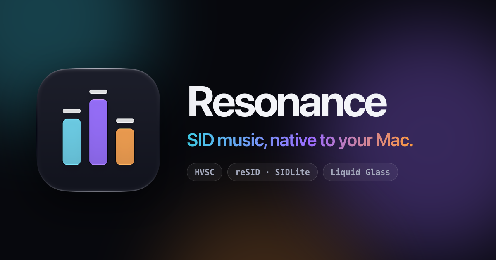

<p align="center">
  <a href="https://erikluimes.github.io/resonance/">
    
  </a>
</p>

<p align="center">
  <strong>A native macOS player for Commodore 64 music.</strong><br>
  All of the High Voltage SID Collection, a fingerprint of how every tune sounds,<br>
  visualizers that show every note, and an interface made of Liquid Glass.
</p>

<p align="center">
  <a href="https://erikluimes.github.io/resonance/"></a>
  
  
  
  <a href="https://github.com/ErikLuimes/resonance/blob/main/apple/LICENSE"></a>
</p>

<p align="center">
  <a href="https://erikluimes.github.io/resonance/"><b>Website &amp; tour</b></a> ·
  <a href="#features">Features</a> ·
  <a href="#getting-started">Getting started</a> ·
  <a href="#keyboard-shortcuts">Shortcuts</a> ·
  <a href="#build-from-source">Build</a> ·
  <a href="#built-on-phosphor">Built on Phosphor</a>
</p>

---

The SID chip inside the Commodore 64 had three voices, four waveforms and one resonant
filter, and composers turned that into some of the most loved music in gaming and the
demoscene. **Resonance** is a SwiftUI app made only for the Mac that brings the High Voltage
SID Collection — more than 60,000 tunes — to your desktop, and shows you exactly how each one
is played.

> **See it first:** the [website](https://erikluimes.github.io/resonance/) has a tour of the app,
> with sound: Sounds Like, the Now Playing visualizers, searching HVSC and playlists.

## Features

### Discover by sound

- **Sounds Like.** Resonance listens to every tune in HVSC in the background and keeps a
  fingerprint of how it sounds: its waveforms, arpeggios, filter sweeps, drums and bass. Play
  anything and the inspector lists the tunes that sound most like it, each a click away.
- **Find Similar and Sound filters.** Sort any list by likeness to one tune, or keep only the
  tunes with arpeggios, filter sweeps, noise drums, ring mod, sync leads or digi samples.
- **Composers who sound similar.** Every composer's card names the composers whose music
  sounds most like theirs.

### All of HVSC, one click away

- **Download and update from the app.** Resonance fetches the collection for you, checks the
  mirror for a newer release, and updates in one click, then shows what the new release added.
- **The HVSC Home.** The release at a glance: what's new, Phosphor's curated playlists, the
  tunes you played last, and the collection's own documents.
- **Musicians, Games and Demos.** Composers by handle and real name, with their tune count,
  years active and Play, Shuffle and Add to… on their card.
- **One search for everything.** Composers in any word order ("jeroen tel"), titles, years and
  labels, spelled either way ("second reality" finds *2nd Reality*). From any list, one step
  takes the search to all of HVSC.
- **Surprise Me and Shuffle Collection.** A radio of random tunes from the whole collection
  (<kbd>⇧</kbd><kbd>⌘</kbd><kbd>R</kbd>), or every tune in HVSC once, in a new order.

### See the music

- **Now Playing.** A full-window player with four visualizers: Halo, Particles, Radial and the
  Sound Map (<kbd>⇧</kbd><kbd>⌘</kbd><kbd>F</kbd>).
- **Sound Map.** Every note the tune plays becomes a point in 3D, placed by its timbre, so
  notes that sound alike gather together and the music draws its own map as it plays.
- **Every voice, live.** The inspector's visualizer shows each SID voice as a scope, as level
  bars with peak hold, or as its envelope, with the note and waveform it's playing.
- **Themes.** Colour the three voices Resonance, C64, Noir, Ember, Abyss, Phosphor, Greyscale
  or your own.

### Know the tune

- **Who made it, and why.** The composer gets a card with STIL's notes on them; covers read
  "Cover of … by …" with the original a click away; STIL's stories and interviews are set as
  quotes, and composers who have passed away are remembered.
- **Known bugs.** HVSC's list of tunes that misbehave in emulation shows on the tunes it names.

### Your music

- **Playlists and Favourites.** Make as many playlists as you like, heart tunes into
  Favourites (shared with Phosphor), and add anything with **Add to…**, which finds a playlist
  as you type. Drag tunes onto a playlist in the sidebar, or reorder them inside it.
- **Always know what's playing from.** "Playing from Rob Hubbard", "Playing from Search
  'commando'": every source is named, and one click takes you back to it.
- **A proper Mac app.** Now Playing in Control Center, your keyboard's media keys, a Playback
  menu with shortcuts, and drag and drop for SID files, folders and M3U playlists.

### Under the hood

- **Two engines.** SIDLite (from libsidplayfp) picks the chip model from each tune's header;
  reSID emulates the chip cycle by cycle. Switch any time.
- **Stereo, your way.** 2SID and 3SID tunes, mirrored stereo for 2SID, and three widths of
  pseudo-stereo for mono tunes.
- **Song lengths and subtunes.** The HVSC Songlengths database moves on at the right moment,
  and subtunes are a click away (<kbd>⌥</kbd><kbd>⌘</kbd><kbd>←</kbd> / <kbd>→</kbd>).

## Getting started

**Requirements:** a Mac with Apple silicon running macOS 27 or later.

1. **Install.** Download the latest build from
   [Releases](https://github.com/ErikLuimes/resonance/releases), open it and drag Resonance into
   Applications. No release yet? [Build it yourself](#build-from-source) — it takes a few minutes.
2. **Get the collection.** No HVSC yet? Click **Download** next to Collection in the sidebar:
   Resonance fetches the newest release into the folder Phosphor uses. Already have it? It's
   found in Phosphor's folder, or choose yours in **Settings → Collection**.
3. **Press <kbd>⇧</kbd><kbd>⌘</kbd><kbd>R</kbd>.** Surprise Me starts the radio. Or drop SID
   files, folders and M3U playlists onto the window. Fingerprinting starts on its own and takes
   a few hours for all of HVSC; Sounds Like fills in as it goes.

> [!NOTE]
> Resonance shares Phosphor's data folder (`~/Library/Application Support/phosphor/`): the
> collection, song lengths, STIL, play history and favourites. Both apps see the same library,
> and you can use them side by side.

## Keyboard shortcuts

| Shortcut | Action |
| --- | --- |
| <kbd>Space</kbd> | Play / Pause (in the playlist) |
| <kbd>⌘</kbd> <kbd>.</kbd> | Stop |
| <kbd>⌘</kbd> <kbd>←</kbd> / <kbd>→</kbd> | Previous / next track |
| <kbd>⌥</kbd> <kbd>⌘</kbd> <kbd>←</kbd> / <kbd>→</kbd> | Previous / next subtune |
| <kbd>⇧</kbd> <kbd>⌘</kbd> <kbd>R</kbd> | Surprise Me |
| <kbd>⇧</kbd> <kbd>⌘</kbd> <kbd>F</kbd> | Show or hide Now Playing |
| <kbd>⌘</kbd> <kbd>↑</kbd> / <kbd>↓</kbd> | Volume up / down |
| <kbd>⌥</kbd> <kbd>⌘</kbd> <kbd>S</kbd> | Shuffle |
| <kbd>⌘</kbd> <kbd>O</kbd> | Add files or folders |
| <kbd>⌘</kbd> <kbd>,</kbd> | Settings |

## Build from source

You'll need **Xcode 27** and **Rust**:

```bash
brew install rustup && rustup default stable
```

Then clone, build and launch:

```bash
git clone https://github.com/ErikLuimes/resonance.git
cd resonance
xcodebuild -project apple/Resonance.xcodeproj -scheme Resonance -derivedDataPath apple/build/DD build
open apple/build/DD/Build/Products/Debug/Resonance.app
```

Or open `apple/Resonance.xcodeproj` and run the **Resonance** scheme. The first build compiles
the Rust engine and takes a few minutes; after that Xcode rebuilds it incrementally.

How the app, the Rust bridge and the engine fit together, how to run the tests, and how to pull
in Phosphor updates is all in the [developer guide](https://github.com/ErikLuimes/resonance/blob/main/apple/README.md).

## Built on Phosphor

Resonance stands on the shoulders of
**[Phosphor](https://github.com/sandlbn/Phosphor)**, Marcin Spoczynski's open-source SID
player for macOS, Windows and Linux, written in Rust with an Iced interface. Resonance doesn't
reimplement SID playback: it compiles Phosphor's engine **unchanged** and talks to it through
[UniFFI](https://github.com/mozilla/uniffi-rs), so improvements upstream flow straight into the
Mac app.

```
Resonance.app            SwiftUI · Swift 6 · Liquid Glass
  └ PhosphorCore         UniFFI-generated Swift bindings
      └ phosphor-apple   Rust: session, driver thread, FFI
          └ Phosphor     reSID · SIDLite · HVSC · Songlengths · STIL — compiled from src/
```

This repository is based on Phosphor's, so you'll find both here:

| Path | What it is |
| --- | --- |
| [`apple/`](https://github.com/ErikLuimes/resonance/tree/main/apple) | **Resonance**: the SwiftUI app, the Rust bridge and the website |
| `src/`, `Cargo.toml` | Phosphor's engine and Iced app, kept identical to upstream |
| `README.md`, `docs/` | Phosphor's own README and website |

**Want real hardware?** Phosphor plays through a
[USBSID-Pico](https://github.com/LouDnl/USBSID-Pico) or an [Ultimate 64](https://ultimate64.com/),
and has a DSP pedalboard, a web remote and karaoke for MUS files. Resonance doesn't do those
yet — for them, use [Phosphor](https://sandlbn.github.io/Phosphor/).

## License & credits

Resonance's own code (everything under `apple/`) is released under the
[MIT License](https://github.com/ErikLuimes/resonance/blob/main/apple/LICENSE), © 2026 Erik Luimes.
Phosphor is © 2026 Marcin Spoczynski, also
[MIT-licensed](https://github.com/ErikLuimes/resonance/blob/main/LICENSE).

SID emulation by reSID (through resid-rs), SIDLite and libsidplayfp, which are
GPL-licensed: the Resonance app as built and distributed is therefore covered by the
[GNU GPL, version 3](https://www.gnu.org/licenses/gpl-3.0.html), with its full source
here. About Resonance → Acknowledgements lists every library in the app.

Tunes, song lengths and STIL come from the
[High Voltage SID Collection](https://hvsc.c64.org); the music belongs to its composers.
